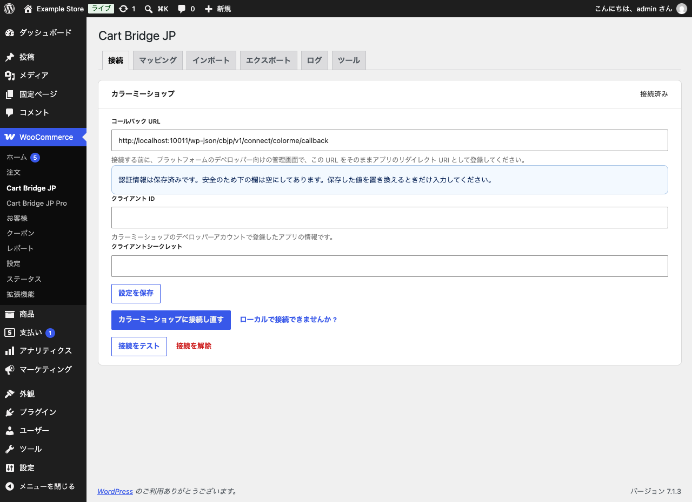

# インストールと接続

## 無料版をインストールする

1. 先に WooCommerce をインストールして有効化します。
2. 管理画面の「プラグイン」→「新規プラグインを追加」で「Cart Bridge JP」を検索し、「Cart Bridge JP – Migrate for WooCommerce」をインストールして有効化します。

有効化すると、管理画面の「WooCommerce」の下に「Cart Bridge JP」のメニューができます。

## Pro をインストールする

1. 販売サイト（https://wc.artws.info/）で Cart Bridge JP Pro を入手します。購入する前に試すときは、0 円の Pro を注文してください。どちらも同じプラグインで、購入したライセンスキーを後から有効化すると、入れ直さずにすべての機能が使えるようになります。
2. 注文の後に、プラグインの zip ファイル（`cart-bridge-jp-pro-<バージョン>.zip`）をダウンロードします。
3. 管理画面の「プラグイン」→「新規プラグインを追加」→「プラグインのアップロード」で zip ファイルを選び、インストールして有効化します。

Pro は、WooCommerce と無料版が有効になっていないと有効化できません。有効化すると、「WooCommerce」の下に「Cart Bridge JP Pro」のメニューができます。

## カラーミーショップに接続する

「WooCommerce」→「Cart Bridge JP」の「接続」タブで接続します。

1. 「コールバック URL」に表示された URL をコピーします。
2. カラーミーショップのデベロッパーセンターで、移行に使うアプリのリダイレクト URI にこの URL を登録します。
3. アプリの「クライアント ID」と「クライアントシークレット」を入力し、「設定を保存」をクリックします。
4. 「カラーミーショップに接続」をクリックします。開いた画面にショップのオーナーのアカウントでログインし、アプリを承認します。
5. 画面の右上が「接続済み」になったら、「接続をテスト」で接続を確かめます。

{width=100%}

認証情報は暗号化して保存します。保存した後は、安全のため入力欄を空にして表示します。値を置き換えるときだけ入力してください。

### サイトがインターネットから見えないとき

ローカルの開発環境などで、カラーミーショップがコールバック URL に戻れないときは、「ローカルで接続できませんか？」から手動で接続できます。この方法では、先にアプリのリダイレクト URI を `urn:ietf:wg:oauth:2.0:oob` に変えてください（画面の案内に従います）。承認の後に表示されるコードを貼り付けて接続します。

### 無料版で接続した後に Pro を入れたとき

無料版は、商品の読み書きの権限だけを求めてカラーミーショップに接続します。Pro を有効にすると、顧客・受注・クーポンの権限も必要になるため、「接続」タブに「この接続には、一部の種類の記録に必要な権限がありません」という案内が出ます。「カラーミーショップに接続し直す」をクリックし、もう一度アプリを承認してください。

### 接続を解除する

「接続を解除」で、このサイトに保存した接続を消せます。カラーミーショップの側のアプリの承認は残るので、使わなくなったらカラーミーショップの管理画面で承認を取り消してください。
