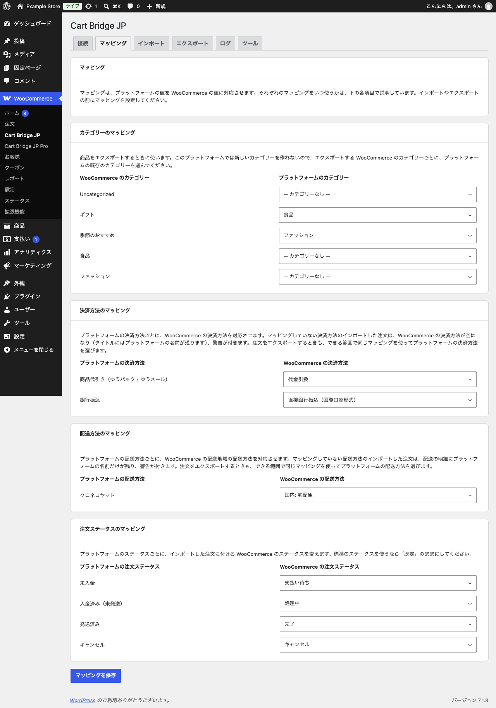

# マッピング

「マッピング」タブでは、カラーミーショップの値を WooCommerce のどの値に当てるかを決めます。取り込み・エクスポートの前に設定してください。設定したら「マッピングを保存」をクリックします。

{width=90%}

## カテゴリーのマッピング（無料版）

商品を**エクスポート**するときに使います。カラーミーショップの API ではカテゴリーを作れないので、エクスポートする WooCommerce のカテゴリーごとに、カラーミーショップの既存のカテゴリーを選びます。取り込みでは使いません（取り込みはカラーミーショップのカテゴリーを WooCommerce に作ります）。

## 決済方法のマッピング（Pro）

カラーミーショップの決済方法ごとに、WooCommerce の決済方法を選びます。マッピングしていない決済方法の注文を取り込むと、WooCommerce の決済方法は空になり（注文の決済方法の名前にはカラーミーショップの名前が残ります）、警告が付きます。

## 配送方法のマッピング（Pro）

カラーミーショップの配送方法ごとに、WooCommerce の配送地域の配送方法を選びます。候補は「WooCommerce」→「設定」→「配送」で作った配送地域と配送方法です。マッピングしていない配送方法の注文を取り込むと、配送の明細にカラーミーショップの名前だけが残り、警告が付きます。

## 注文ステータスのマッピング（Pro）

カラーミーショップの状態（未入金・入金済み（未発送）・発送済み・キャンセル）ごとに、取り込んだ注文に付ける WooCommerce のステータスを選びます。標準のステータスを使うなら「既定」のままにしてください。

決済方法・配送方法のマッピングは、注文をエクスポートするときも、できる範囲で同じ対応を使ってカラーミーショップの値を選びます。
