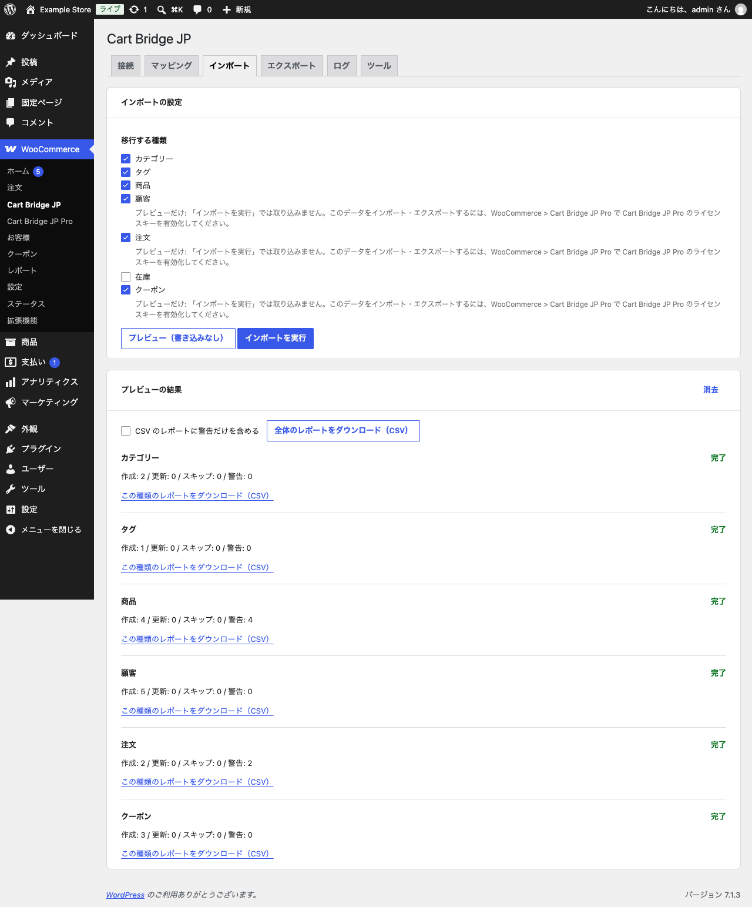

# プレビュー（dry-run）で確かめる

プレビューは、カラーミーショップのデータを読み、WooCommerce に書き込んだらどうなるかを、**何も書き込まずに**確かめる実行です。件数の制限はありません。顧客・受注・クーポンのプレビューは、ライセンスキーを有効化していない Pro でも実行できます。購入する前に、ご自身のショップの全件で確かめてください。

## 実行する

1. 「WooCommerce」→「Cart Bridge JP」の「インポート」タブを開きます。
2. 「移行する種類」で、確かめたい種類にチェックを付けます。
3. 「プレビュー（書き込みなし）」をクリックします。

ライセンスキーを有効化していない間は、顧客・注文・クーポンの下に「プレビューだけ: 『インポートを実行』では取り込みません。」という案内が出ます。プレビューには含まれます。

{width=100%}

在庫のプレビューは、商品をまだ取り込んでいないと、すべて「商品がまだ無い」として見送りになります。在庫は商品を取り込んだ後に確かめてください。

## 結果の見方

「プレビューの結果」に、種類ごとの件数が出ます。

| 項目 | 意味 |
| --- | --- |
| 作成 | 新しく作るもの |
| 更新 | すでに取り込んであり、内容が変わったので更新するもの |
| スキップ | 取り込まないもの（理由はレポートにあります） |
| 警告 | 注意が要るもの。取り込まれるものも、取り込まれないものもあります |

右の「完了」は、その種類のプレビューが終わったことを示します。データが多いと時間がかかります。カラーミーショップの API の利用制限（1 分あたりの回数）に達すると「一時停止中（利用制限）」になり、自動で再開します。

## レポート（CSV）

「全体のレポートをダウンロード（CSV）」で、すべての種類の結果を 1 つの CSV ファイルで保存できます。種類ごとのレポートもあります。「CSV のレポートに警告だけを含める」にチェックを付けると、警告のある行だけになります。

- 1 つの警告が 1 行です。警告が複数あるデータは複数の行になり、そのデータの結果（`operation` の列: `created`・`updated`・`skipped`）はどの行も同じです。
- `severity` が `blocking` の警告が、データを止めている警告です。先に直してください。
- 警告ごとに、原因と、できるときは直し方が書かれています。

レポートに出ない記録（カラーミーショップの ID が無いものなど）は、「ログ」タブに残ります。

警告を直したら、もう一度プレビューして確かめます。問題が無ければ、ライセンスキーを有効化して取り込みます。
