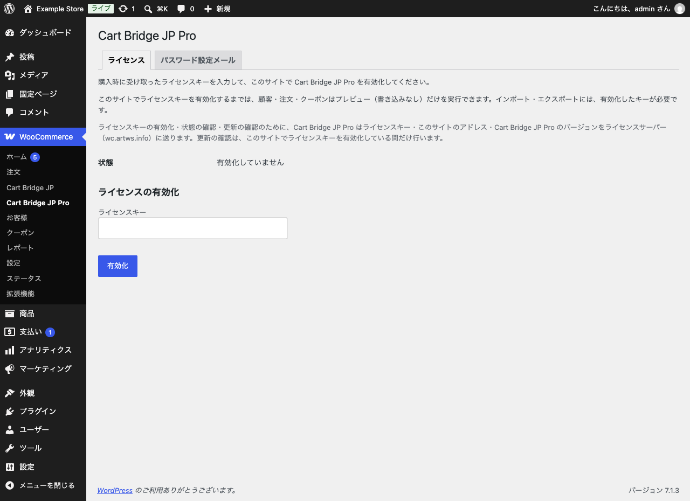
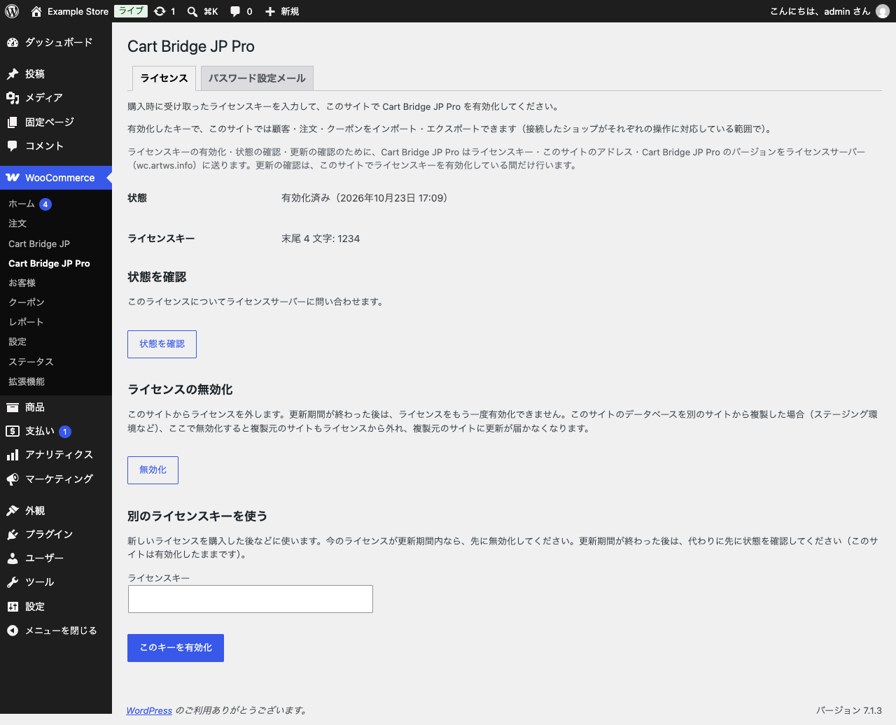

# ライセンスを有効化する

## ライセンスキーが無い間にできること

| 機能 | キーが無いとき | キーを有効化した後 |
| --- | --- | --- |
| 顧客・受注・クーポンのプレビュー | ○ | ○ |
| 顧客・受注・クーポンの取り込み・エクスポート | — | ○ |
| パスワード設定メールの送り先の確認・テストメール | ○ | ○ |
| パスワード設定メールの一斉送信の開始・再開 | — | ○ |
| Pro のアップデートの受け取り | — | ○（期限内） |

商品・カテゴリー・在庫は無料版の機能なので、キーに関係なく使えます。

## 有効化する

1. 販売サイト（https://wc.artws.info/）で Cart Bridge JP Pro のライセンスを購入し、ライセンスキーを受け取ります。
2. 「WooCommerce」→「Cart Bridge JP Pro」の「ライセンス」タブを開きます。
3. 「ライセンスキー」にキーを入力し、「有効化」をクリックします。

{width=100%}

「状態」が「有効化済み」になれば完了です。プラグインを入れ直す必要はありません。

{width=100%}

ライセンスキーの有効化・状態の確認・更新の確認のために、Pro はライセンスキー・このサイトのアドレス・Pro のバージョンを、ライセンスサーバー（wc.artws.info）に送ります。更新の確認は、ライセンスキーを有効化している間だけ行います。

## ライセンスの期間

- 1 つのライセンスキーを、サイトの数に制限なく有効化できます（本番・ステージング・検証用など）。
- 初回の有効化から 3 か月間、アップデートとメールでのサポートを受けられます。
- 期限が過ぎても、有効化済みのサイトではそのまま使い続けられます。新しいサイトでの有効化と、アップデートの受け取りはできなくなります。新しい移行の案件では、改めてご購入ください。
- 購入後の返金には対応していません。購入する前に、プレビューで結果を確かめてください。

## 有効化した後の操作

- **状態を確認**: ライセンスサーバーに、このライセンスの状態を問い合わせます。
- **無効化**: このサイトからライセンスを外します。更新期間が終わった後は、同じライセンスをもう一度有効化できません。
- **別のライセンスキーを使う**: 新しいライセンスを購入したときなどに使います。今のライセンスが更新期間内なら、先に無効化してください。更新期間が終わった後は、先に「状態を確認」をクリックしてください（このサイトは有効化したままです）。

**データベースを複製したサイトでの無効化に注意してください。** 本番のデータベースを複製してステージングを作った場合、ステージングで「無効化」すると複製元の本番のサイトもライセンスから外れ、本番に更新が届かなくなります。
