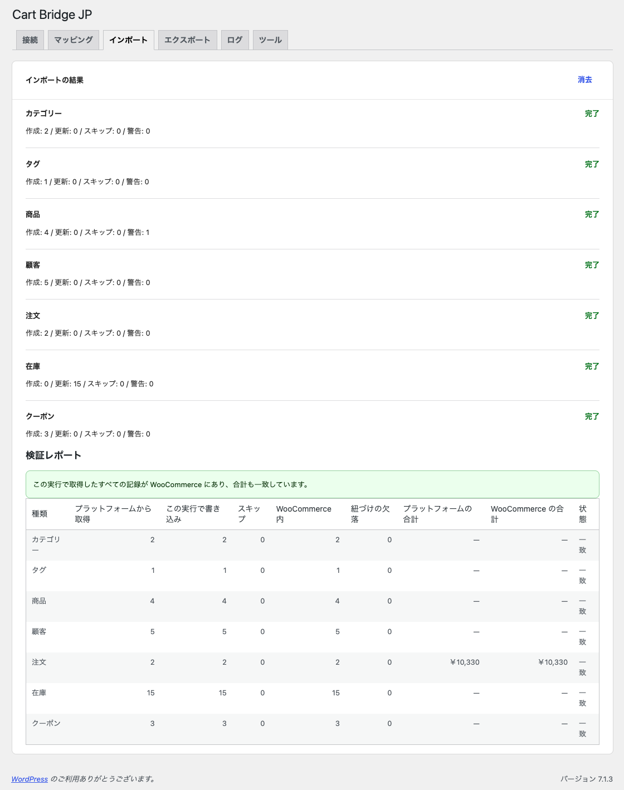

# 取り込む（インポート）

## 取り込む前に

- サイトのバックアップを取ってください。
- 「マッピング」タブで、決済方法・配送方法・注文ステータスを設定してください。
- プレビューの警告を確かめ、直せるものは直してください。

## 実行する

1. 「インポート」タブの「移行する種類」で、取り込む種類にチェックを付けます。最初の移行では、すべての種類をまとめて取り込むことをおすすめします。注文は、取り込んだ顧客と商品に結び付きます。
2. 「インポートを実行」をクリックします。
3. 「このサイトに WooCommerce の実データ（選んだ種類）を書き込みます。続けますか ?」という確認が出たら、内容を確かめて OK をクリックします。

取り込みは、カテゴリー → タグ → 商品 → 顧客 → 注文 → 在庫 → クーポンの順に、バックグラウンドで少しずつ進みます。サイトへのアクセスが少ないと進みが遅くなることがあるので、終わるまで画面を開いておくことをおすすめします。

途中で止めるときは「実行をキャンセル」をクリックします。失敗した種類は「再試行」で続きから実行できます。

## 結果と検証レポート

すべての種類が「完了」になると、「インポートの結果」の下に検証レポートが出ます。

{width=100%}

検証レポートは、この実行でカラーミーショップから取得した件数と、WooCommerce にある件数を種類ごとに突き合わせます。注文は、カラーミーショップと WooCommerce の合計金額も比べます。

| 列 | 意味 |
| --- | --- |
| プラットフォームから取得 | カラーミーショップから読んだ件数 |
| この実行で書き込み | この実行で作成・更新した件数 |
| スキップ | 取り込まなかった件数 |
| WooCommerce 内 | 紐づけのある WooCommerce のデータの件数 |
| 紐づけの欠落 | 紐づけが残っているのに、WooCommerce のデータが無くなっている件数 |
| プラットフォームの合計・WooCommerce の合計 | 注文の合計金額 |
| 状態 | 「一致」なら、取得したすべての記録が WooCommerce にあり、合計も一致しています |

## 取り込んだデータについて

- **顧客**: カラーミーショップの会員を、WooCommerce の顧客として作ります。カラーミーショップのパスワードは移せないため、ランダムなパスワードでアカウントを作ります。同じメールアドレスのアカウントがすでにあれば、新しく作らずに結び付けます。フリガナ・生年月日・メールマガジンの購読の有無など WooCommerce に項目の無い値も、顧客のデータとして残します。
- **注文**: 注文番号・注文日時・明細・金額・決済方法・配送先・ステータスを取り込みます。取り込んだ注文で、在庫が減ったり、注文のメールが送られたりはしません。
- **クーポン**: コード・割引の種類と額・最低購入金額・有効期限・利用回数の上限・送料無料の設定を取り込みます。WooCommerce で表せない条件を持つクーポンは、条件を落として作ることはせず、取り込みを見送ります。
- **メール**: 取り込みでは、顧客にも店舗にもメールを送りません。顧客へのメールは、管理者がパスワード設定メールの送信を始めたときだけ送られます。

## もう一度取り込むとき

同じショップからもう一度取り込むと、紐づけのあるデータは新しく作らずに更新します。内容が変わっていないデータはそのままです。
