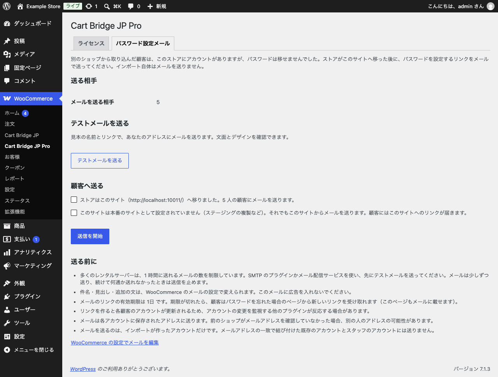

# パスワード設定メールを送る

取り込んだ顧客は WooCommerce にアカウントがありますが、カラーミーショップのパスワードは移せません。新しいストアに切り替えた後に、顧客へパスワードを設定するためのリンクをメールで送ります。取り込み自体はメールを送らないので、送る時期は管理者が決められます。

「WooCommerce」→「Cart Bridge JP Pro」の「パスワード設定メール」タブで送ります。

{width=100%}

## 送る前に用意するもの

- **マイアカウントのページ**: メールのリンクには、WooCommerce のマイアカウントのページと、パスワード紛失のエンドポイントが要ります。無いときは画面に案内が出ます。マイアカウントのページを公開し、WooCommerce の設定でエンドポイントを設定してください。
- **メールの送信の設定**: 多くのレンタルサーバーは、1 時間に送れるメールの数を制限しています。SMTP のプラグインかメール配信サービスを使ってください。
- **メールの文面**: 件名・見出し・追加の文は、「WooCommerce」→「設定」→「メール」で変えられます（画面の「WooCommerce の設定でメールを編集」から開けます）。このメールに広告を入れないでください。

## 送る

1. 「送る相手」で、メールを送る顧客の数を確かめます。
2. 「テストメールを送る」で、ご自身のアドレスに見本のメールを送り、文面とデザインを確かめます（見本の名前とリンクを使います）。
3. ストアが新しいサイトに移ったら、「顧客へ送る」の確認にチェックを付けます。ステージングなど、本番として設定されていないサイトでは、もう 1 つの確認も出ます（顧客には、このサイトへのリンクが届きます）。
4. 「送信を開始」をクリックします。

メールはバックグラウンドで少しずつ送ります。続けて何通か送れなかったときは、送信を止めます。止まった送信や中断した送信は、画面から再開できます。送信中は取り消すこともできます（送ったメールは取り消せません）。

一斉送信の開始と再開には、ライセンスキーの有効化が必要です。送る相手の確認とテストメールは、キーが無くても使えます。

## 送る相手

- 送るのは、取り込みで作ったアカウントだけです。メールアドレスの一致で結び付けた既存のアカウントと、スタッフのアカウントには送りません。
- 送った相手は記録するので、同じ顧客に二重に送りません。
- すでにパスワードを設定し直した顧客には送りません。
- メールは、各アカウントに保存されたアドレスに送ります。前のショップがメールアドレスを確認していなかった場合は、別の人のアドレスの可能性があります。

## 顧客に届くメール

- ストアの移転と、パスワードを設定するリンクの案内です。
- リンクの有効期限は 1 日です。期限が切れたときは、顧客はパスワードを忘れた場合のページから新しいリンクを受け取れます（このページもメールに載せます）。
- リンクを作ると各顧客のアカウントが更新されるため、アカウントの変更を監視する他のプラグインが反応する場合があります。
