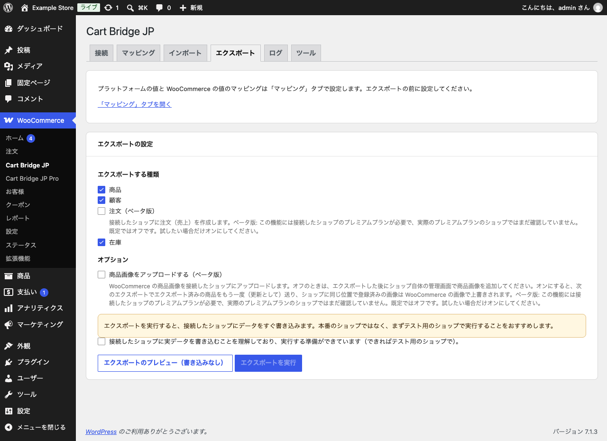
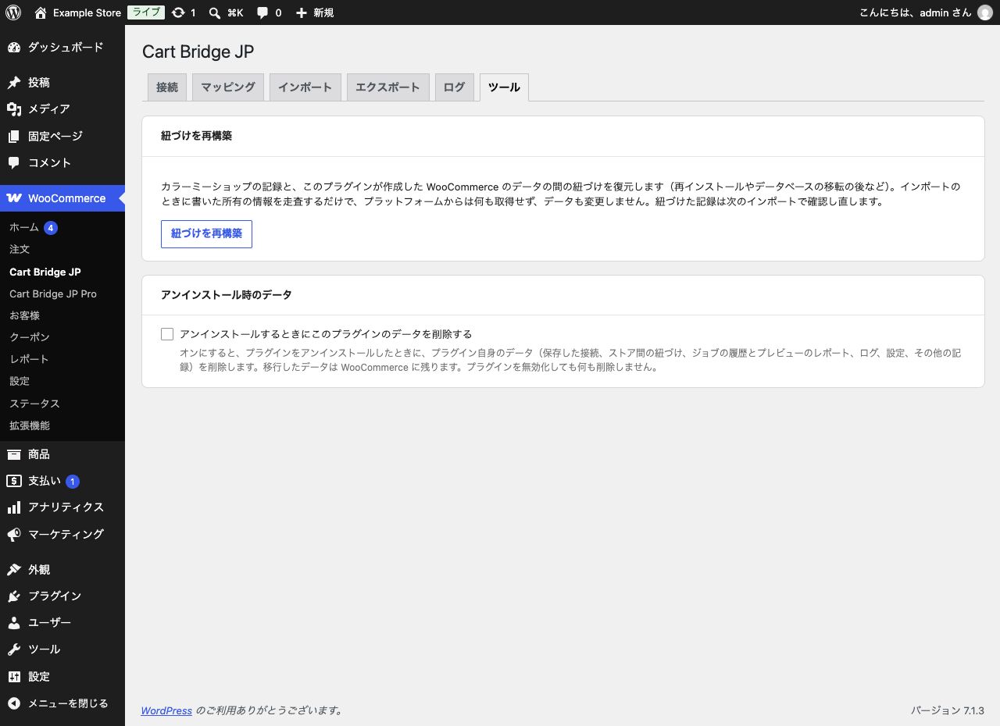

# エクスポートとツール

## エクスポート（WooCommerce → カラーミーショップ）

WooCommerce のデータをカラーミーショップに書き込みます。WooCommerce からカラーミーショップへ移るときに使います。Pro を有効にすると、商品・在庫（無料版）に加えて、顧客と注文（ベータ版）を選べます。

{width=100%}

1. 「マッピング」タブで、カテゴリーのマッピング（と、注文を送るなら決済方法・配送方法）を設定します。
2. 「エクスポートする種類」を選び、「エクスポートのプレビュー（書き込みなし）」で結果を確かめます。
3. 「接続したショップに実データを書き込むことを理解しており、実行する準備ができています（できればテスト用のショップで）。」にチェックを付け、「エクスポートを実行」をクリックします。

- エクスポートは、接続したショップにデータをすぐ書き込みます。本番のショップではなく、まずテスト用のショップで実行することをおすすめします。
- **注文（ベータ版）**: 接続したショップに注文（売上）を作ります。カラーミーショップのプレミアムプランが必要で（プレミアムプランのショップに接続したときだけ選択肢が出ます）、プレミアムプランの実店舗ではまだ確かめていません。既定ではオフです。
- **商品画像をアップロードする（ベータ版）**: オフのときは、エクスポートした後にカラーミーショップの管理画面で商品画像を追加してください。オンにすると、同じ位置に登録済みの画像は WooCommerce の画像で上書きされます。プレミアムプランが必要です。
- クーポンは、カラーミーショップの API が読み取りだけなので、エクスポートできません。
- カラーミーショップから取り込んだデータは、カラーミーショップへエクスポートされません（一方向の移行のため）。

## ツール

{width=100%}

### 紐づけを再構築

カラーミーショップの記録と、このプラグインが作った WooCommerce のデータの間の紐づけを復元します。プラグインを入れ直した後や、データベースを移した後に使います。取り込みのときに書いた所有の情報を走査するだけで、カラーミーショップからは何も取得せず、データも変更しません。

エクスポートで作ったデータの紐づけは復元できません。プラグインのデータを消した後にもう一度エクスポートすると、カラーミーショップに重複して作られます。

### アンインストール時のデータ

既定では、プラグインを削除しても、移行したデータとプラグイン自身のデータ（保存した接続・紐づけ・ジョブの履歴・ログ・設定）は残ります。入れ直せば続きから使えます。「アンインストールするときにこのプラグインのデータを削除する」にチェックを付けると、削除するときにプラグイン自身のデータも消します（移行したデータは WooCommerce に残ります）。プラグインを無効化しただけでは、何も削除しません。

## ログ

「ログ」タブに、実行中の記録とエラーが残ります。プレビューのレポートに出ない理由も、ここで確かめられます。
